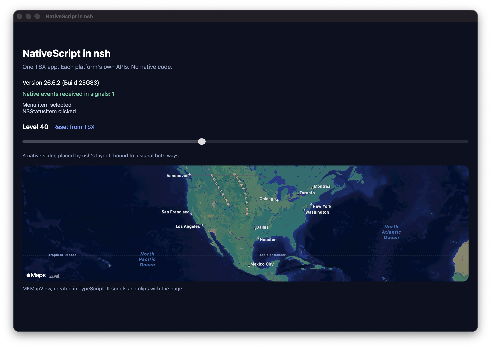
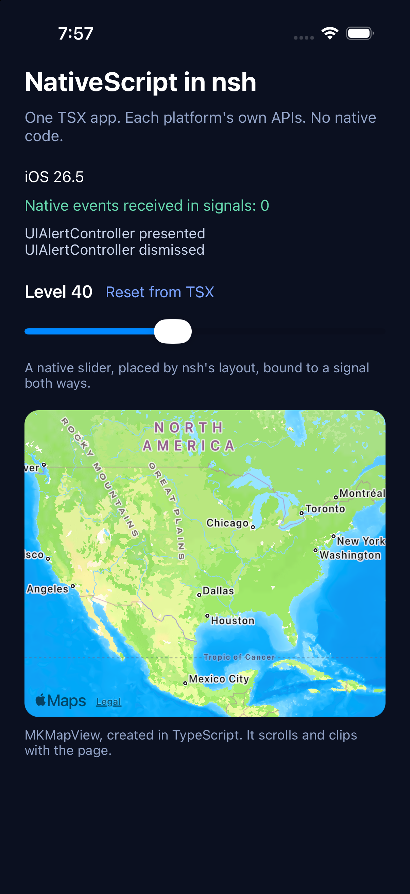
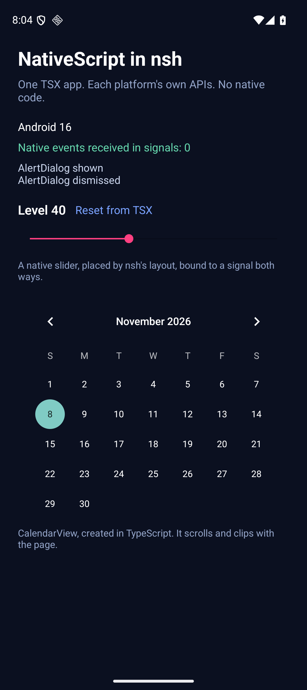

# NativeScript in Native Shell

**Call any AppKit, UIKit or Android API directly from a [Native Shell](https://nsh.dev) (`nsh`) TSX app, with no Rust, Swift, Kotlin or Java.**

This repo runs NativeScript inside `nsh`'s own JavaScript VM. One TSX app reaches each platform's real native APIs, places native views in `nsh`'s layout, and updates live as you edit. Native callbacks update `nsh` signals.

| macOS | iOS | Android |
| :---: | :---: | :---: |
|  |  |  |

> Experimental, and not an official NativeScript or `nsh` release. Tested on a macOS 26 Mac, an iOS 26.5 simulator and an Android 16 emulator. `nsh` needs three small hooks ([patch](patches/nsh-hooks.patch)), which would need to land upstream.

## What it looks like

A real menu bar item, in TypeScript, in the same VM as your `nsh` signals:

```tsx
const clicks = signal(0);

const item = NSStatusBar.systemStatusBar.statusItemWithLength(NSVariableStatusItemLength);
item.button.image = NSImage.imageWithSystemSymbolNameAccessibilityDescription("bolt.fill", "Status");
item.button.target = target; // a NativeClass whose action calls clicks.set(clicks() + 1)

mount(() => <Text>Clicks: {clicks()}</Text>);
```

A native view in `nsh`'s layout, written in TypeScript and bound to a signal both ways:

```tsx
<NativeView
  style={{ height: 36, alignSelf: "stretch" }}
  create={() => controls.slider((value) => level.set(value))}
  update={(slider) => controls.setSlider(slider, level())}
/>
```

It sizes, scrolls and clips like any other element. Each platform needs only a small generic container, and [`native-view.tsx`](apps/showcase/native-view.tsx) does the rest. The showcase is in [`apps/showcase`](apps/showcase).

## Why it matters

Without this, an API `nsh` doesn't wrap needs native code for each platform. The same macOS tray, with the same click, menu, tooltip and accessibility behaviour:

| | `nsh` built-in tray | This repo |
| :--- | :--- | :--- |
| Language | Rust | TypeScript |
| macOS implementation | [242 lines](https://github.com/longbridge/nsh/blob/36b91689c1e7c38379179a56381de7ddab16c6a5/crates/nsh-platform-macos/src/tray.rs) | [97 lines](apps/showcase/tray.ts) |
| Change it | Rebuild and ship the framework | Rebundle in milliseconds |

The built-in tray also loads icons through `nsh`'s image pipeline and offers one API across platforms. The TypeScript version takes SF Symbols and is macOS only.

## Performance

Median of five process runs, each the median of seven timed loops, in nanoseconds.

**Calling a platform API that must run on the main thread:**

| Route | macOS | iOS simulator | Android emulator |
| :--- | ---: | ---: | ---: |
| Rust `nsh` module, standard route (`dispatch_sync` / `Handler`) | 8,162 | 8,106 | 92,558 |
| Rust `nsh` module, using this bridge's hand-off | 189 | 204 | 267 |
| **TypeScript through NativeScript** | **733** | **434** | **422** |

**Updating the tray** (macOS, two AppKit property sets per update):

| Route | Time |
| :--- | ---: |
| Rust `nsh` module, standard route | 8,873 |
| Rust `nsh` module, using this bridge's hand-off | 619 |
| **TypeScript through NativeScript** | **1,960** |

**Calls that can stay off the main thread:**

| Route | macOS | iOS simulator | Android emulator |
| :--- | ---: | ---: | ---: |
| Rust `nsh` module | 38 | 49 | 61 |
| TypeScript through NativeScript | 532 | 291 | 223 |

What this shows:

- **TypeScript is 11–219× faster than the standard Rust route** to the main thread, because that route wakes a sleeping thread on every call.
- **Rust is still faster on equal footing.** With the same hand-off, TypeScript adds 0.15–0.54 µs per call for full dynamic access, with no native code to write or ship.
- **Calls that don't need the main thread are where NativeScript costs the most**: 4–14× slower than Rust, though still under a microsecond.

The first call after both threads have gone idle pays a full thread wake-up on every route, and costs roughly the same for Rust and TypeScript. Results come from a simulator and emulator on one Mac, so they do not represent a phone. Raw data is in [`apps/bench/results`](apps/bench/results).

## Size and memory

What adding NativeScript costs, measured against the same app with NativeScript off. "Trimmed" keeps only the native APIs the app uses, plus the types they depend on.

| | macOS | iOS | Android |
| :--- | ---: | ---: | ---: |
| API metadata, full SDK | 4.7 MB | 4.6 MB | 2.9 MB |
| **API metadata, trimmed for the showcase** | **0.67 MB** | **0.83 MB** | **0.81 MB** |
| Added on disk, full SDK | 8.2 MB | 7.2 MB | 6.7 MB |
| **Added on disk, trimmed** | **4.2 MB** | **3.4 MB** | **about 4.6 MB** |
| Added to a compressed download, full SDK | 2.4 MB | 1.9 MB | 2.6 MB |
| **Added to a compressed download, trimmed** | **0.95 MB** | **0.84 MB** | **about 1.9 MB** |
| Extra memory at idle, full SDK | +26 MB | +16 MB | +6 MB |
| **Extra memory at idle, trimmed** | **+6 MB** | **+9 MB** | see below |
| Startup added at launch, full SDK | about 54 ms | about 36 ms | about 35–50 ms |
| **Startup added at launch, trimmed** | **about 37 ms** | **about 17 ms** | no clear change |

Memory and startup use a blank app. iOS numbers come from the simulator and Android's from an emulator. Sizes are for one CPU architecture. The bridge itself is about 75 KB of code on macOS.

On Android, trimming also turns on R8 code shrinking. That took total app memory from 50.0 MB to 40.3 MB and the APK from 23.8 MB to 21.4 MB, but most of that comes from the shrunk app code rather than the metadata, so the Android memory cost of trimmed metadata alone isn't isolated here.

### How trimming works

`ns metadata trim`, a NativeScript CLI command in [draft](https://github.com/NativeScript/nativescript-cli/pull/6203) ([RFC](https://github.com/NativeScript/rfcs/discussions/62)), reads the emitted bundle, lists the native APIs it names, and generates metadata for those and everything they depend on. On Apple platforms it also shrinks the framework binary to fit. If the bundle reads globals dynamically, such as through an alias of `globalThis`, the CLI stops rather than risk removing something the app needs.

## One JavaScript engine

There is one JS engine in the app: the QuickJS that `nsh` already ships.

- NativeScript brings no engine here. Its macOS and iOS packages are engine-agnostic and bind through Node-API, and the Android runtime is built without its own QuickJS.
- TSX, signals and native calls share one VM and one heap, so nothing is copied between engines.
- `nsh` uses `quickjs-jit`, based on quickjs-ng. At the pinned commit the separate JIT compiler is not linked, so JS runs in the bytecode interpreter.
- App logic therefore runs at QuickJS speed, not V8 speed. An empty JS function call takes about 8 ns here and 0.3 ns on V8, so CPU-heavy JS is the main thing that gets slower compared with a standard V8-based NativeScript app.
- The bridge is compiled against `nsh`'s exact QuickJS headers, so it has to be rebuilt when `nsh` upgrades its engine.

## How it works

- `nsh` runs JS on a dedicated engine thread, while platform UI work must run on the main thread.
- NativeScript's runtime is engine-agnostic through Node-API, so [`crates/nsh-ns/c/quickjs-api.c`](crates/nsh-ns/c/quickjs-api.c) provides Node-API on `nsh`'s own QuickJS VM.
- [`baton.c`](crates/nsh-ns/c/baton.c) passes control between the two threads. JS always runs on the engine, and native calls run on main by default.
- Each thread spins briefly on a shared slot before sleeping, so a burst of native calls needs no kernel wake-up after the first.
- On Apple platforms, NativeScript's roughly 60,000 global accessors are built on first use instead of at startup, which saves about 24 MB.
- A native view is an empty container `nsh` lays out. Creating it only reports its address, so the main thread never has to enter JS while `nsh` applies a commit, and TypeScript fills it on the next turn.
- Live edits are evaluated in the running VM, so native objects and app state survive. A from-scratch reload (Cmd+R) needs a new VM, and NativeScript binds to one VM per process, so on macOS the process restarts itself.

## Known limits

- **Experimental.** Not tested on physical phones. Linux and Windows are not implemented yet.
- **Sandbox.** NativeScript bypasses `nsh`'s capability system, so don't enable it for untrusted signed modules.
- **Teardown.** The VM is deliberately never freed once NativeScript is attached, so tearing down a view leaks it.
- **Quitting from JS.** Calling `NSApplication.terminate` directly from JS hangs, because quitting waits on the engine thread that is waiting on the call. Defer it with `performSelector:withObject:afterDelay:`, as a Quit menu item does.
- **Full reloads on phones.** Live edits work on iOS and Android, but a from-scratch reload exits the app there, and it has to be reopened.
- **Trimming.** Apps that look up native APIs by computed names can't be trimmed automatically; `--keep` adds what the analysis can't see. Trimmed builds need the app's own testing, because a missing type only shows up when that code runs.
- **Blocking native calls.** A native module that blocks on the main thread from a JS callback the main thread is waiting on will deadlock.
- **Long blocking calls.** `nsh` interrupts a JS turn after 2 seconds, so use asynchronous sheets over synchronous modals.

Full notes are in [`docs/research-notes.md`](docs/research-notes.md).

## Run it

You need macOS, Rust stable, Node.js, Xcode, and for Android the Android SDK with NDK `30.0.16248370`.

```sh
scripts/setup.sh                       # fetches pinned nsh and NativeScript, applies patches
scripts/run-macos.sh apps/showcase     # macOS
```

iOS simulator:

```sh
(cd vendor/nsh && cargo +stable build -p nsh-ns --release --target aarch64-apple-ios-sim)
scripts/ios-sim.sh apps/showcase <simulator-udid> /tmp/showcase.log
```

Live reload, editing TSX or native-calling TypeScript while the app runs:

```sh
scripts/dev-macos.sh apps/showcase
scripts/dev-ios-sim.sh apps/showcase <simulator-udid> /tmp/showcase.log
scripts/dev-android.sh apps/showcase
```

Trim metadata to what an app uses, with a [NativeScript CLI](https://github.com/NativeScript/nativescript-cli/pull/6203) checkout of the `feat/metadata-trim` branch:

```sh
scripts/build-metadata-tools.sh
NS_CLI=<nativescript-cli checkout> scripts/trim-metadata.sh apps/showcase macos   # also: ios, android
```

The script prints the setting to run the trimmed build with.

Android, with an arm64 emulator running:

```sh
scripts/build-android.sh
cp vendor/nsh/target/aarch64-linux-android/release/libnsh_android_host.so apps/android-host/jniLibs/arm64-v8a/libnsh.so
scripts/android-apk.sh apps/showcase
scripts/android-run.sh 8
```

## License

[MIT](LICENSE), except for third-party code under its own terms:

- [`crates/nsh-ns/c/quickjs-api.c`](crates/nsh-ns/c/quickjs-api.c) is adapted from [NativeScript runtimes](https://github.com/NativeScript/runtimes), and the files in [`patches/`](patches) modify NativeScript runtimes and [`nsh`](https://github.com/longbridge/nsh). These are [Apache-2.0](LICENSE-APACHE).
- The headers in [`crates/nsh-ns/c`](crates/nsh-ns/c) come from QuickJS, Node.js and NativeScript runtimes, and keep their original notices.
